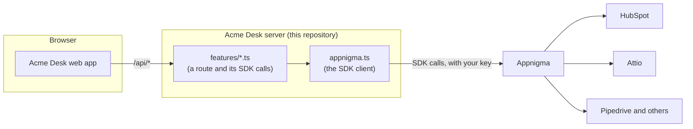

# Appnigma sample app

A small SaaS product, **Acme Desk**, that gives its customers integrations through
the [Appnigma SDK](https://www.npmjs.com/package/@appnigma/sdk). Its customers
connect their CRM (HubSpot, Attio or Pipedrive), see their own companies,
contacts and deals inside the product, and add contacts that land in their CRM.

Acme Desk's own code never talks to HubSpot, Attio or Pipedrive. It makes SDK
calls, and Appnigma builds, runs and maintains the integrations behind them.

Use it as a reference: it makes **every call the SDK has**, each in the place a
real product would, and every one sits next to the route that uses it in
[`server/src/features`](server/src/features), one file per feature. `npm test` fails if a call the
installed SDK has is never made.

## Run it in five minutes

You need Node 22 or newer and an Appnigma SDK key (it starts with `apn_live_`).

```sh
git clone https://github.com/Appnigma/appnigma-sample-app.git
cd appnigma-sample-app
cp .env.example .env    # then put your key in APPNIGMA_SDK_KEY
npm install
npm run dev
```

Open http://localhost:4701 and sign in as one of the sample workspaces.

Connecting a platform sends your customer to the platform and back to
`PUBLIC_URL`. Appnigma only sends people back to an https address, so on your
own machine either set `RETURN_PAGE_URL` to an https page that forwards them
on to `PUBLIC_URL`, or run a tunnel such as ngrok and set `PUBLIC_URL` to its
https address.

## How this app uses Appnigma

| Step | What the user sees | The code |
| --- | --- | --- |
| 1. Create one client | Nothing: it runs on the server | [`appnigma.ts`](server/src/appnigma.ts) |
| 2. Show integrations and connect a customer | The Integrations page, Connect, and the connect form for platforms that take a login | [`features/integrations.ts`](server/src/features/integrations.ts) |
| 3. Read and write their CRM data | The Customers page, Add a contact, company or deal, and editing a record | [`features/customers.ts`](server/src/features/customers.ts) |
| 4. Reach anything else on their platform | Which account they connected, on the integration's page | [`features/integrations.ts`](server/src/features/integrations.ts) |
| 5. Run ready-made actions | The Calls page (Gong transcripts), shown once Gong is switched on | [`features/calls.ts`](server/src/features/calls.ts) |
| 6. Write custom logic | Automations: write a rule in words, check it, try it, put it live, switch it on and off, see its runs; and a link that lets a customer manage their own | [`features/automations.ts`](server/src/features/automations.ts) |
| 7. Hear what happened | Admin → Webhooks and alerts, and Event log; a signed webhook receiver | [`features/webhooks.ts`](server/src/features/webhooks.ts) |
| 8. Keep a copy of their records | Recent changes on each integration's page, kept fresh by a background job | [`jobs/record-sync.ts`](server/src/jobs/record-sync.ts) |
| 9. Look after workspaces | Admin → Workspaces: every connection, and removing a workspace that left | [`features/admin.ts`](server/src/features/admin.ts) |
| 10. Your own functions | Admin → Functions and Developer guide | [`features/admin.ts`](server/src/features/admin.ts) |
| Handle every failure | A clear message instead of a crash | [`errors.ts`](server/src/errors.ts) |

### Every SDK call, and where it is used

| Call | Where | File |
| --- | --- | --- |
| `features.list` | What is switched on, so pages hide what isn't | `features/app.ts` |
| `platforms.list`, `platforms.get` | Integrations page, and one integration's page with its logo and connect form | `features/integrations.ts` |
| `connections.createLink`, `connections.connect` | Connect: by a link to the platform, or from your own form (the SDK encrypts what was typed) | `features/integrations.ts` |
| `connections.get`, `connections.disconnect` | Connection status and Disconnect | `features/integrations.ts` |
| `connections.list`, `endCustomers.delete` | Admin → Workspaces, and the background job finding connected accounts | `features/admin.ts`, `jobs/record-sync.ts` |
| `crm.contacts.*`, `crm.companies.*`, `crm.deals.*` (`list`, `get`, `create`, `update`) | Customers page and its record panel | `features/customers.ts` |
| `request` | Which account they connected, from the platform's own API | `features/integrations.ts` |
| `actions.list`, `actions.run` | An integration's actions, and the Calls page | `features/integrations.ts`, `features/calls.ts` |
| `logic.list`, `get`, `create`, `edit`, `update`, `check`, `test`, `goLive`, `goLiveStatus`, `switchOn`, `switchOff`, `runs`, `discard` | Automations and one automation's page | `features/automations.ts` |
| `portal.createLink` | Automations: let a customer manage their own rules | `features/automations.ts` |
| `webhooks.create`, `webhooks.list`, `webhooks.delete`, `alerts.get`, `alerts.set` | Admin → Webhooks and alerts | `features/webhooks.ts` |
| `events.list` | Admin → Event log | `features/webhooks.ts` |
| `verifyWebhook` | The webhook receiver, before anything reads the body | `features/webhooks.ts` |
| `sync.get`, `sync.set`, `records.changes` | Admin's sync switch, the background job, and Recent changes | `features/webhooks.ts`, `jobs/record-sync.ts` |
| `catalog`, `run`, `guide` | Admin → Functions and Developer guide | `features/admin.ts` |

Each step has a short page in [`docs/`](docs), with a diagram and the exact calls.

Here is all of step 1:

```ts
import { Appnigma } from "@appnigma/sdk";

// Reads your key from APPNIGMA_SDK_KEY. One client for the whole server.
const appnigma = new Appnigma();
```

And reading a customer's contacts, whichever CRM they use:

```ts
const page = await appnigma.crm.contacts.list({ endCustomerId: "Brightline Legal", platform: "hubspot" });
for (const contact of page.records) console.log(contact.fullName, contact.emails[0]?.value);
```

Open **Under the hood** in the app's top bar to watch each SDK call a page
makes, with the line of code that made it.

## How it fits together



- The browser only talks to this app's own server. The SDK key never leaves the server.
- Each feature file holds its routes: it checks the input, makes the SDK calls and answers, right there. `errors.ts` turns any failure into plain words.
- Appnigma keeps each customer's connection and talks to their platforms.

## Project layout

```
server/src/
  appnigma.ts            the one SDK client
  features/              one file per feature: its routes and SDK calls together
  jobs/record-sync.ts    the background job that keeps the record copy fresh
  errors.ts              every failure, in plain words
  session.ts             the sign-in stand-in
  env.ts  inputs.ts  types.ts  under-the-hood.ts  server.ts
server/test/             the check that every SDK call is used
web/src/
  pages/                 Home, Customers, Integrations, one integration, Calls,
                         Automations, one automation, Admin
  components/            layout, Under the hood panel, Admin tabs
docs/                    one page per flow
```

## Make it your own

1. Set `PRODUCT_NAME` and `BRAND_COLOR` in `.env`.
2. Set `PUBLIC_URL` to the https address your users reach. The connect flow sends them back there.
3. Replace the sign-in stand-in (`session.ts` and the session routes in `features/app.ts`) with your own login. Use your own stable id for each customer as their `endCustomerId`.
4. One account in a platform (one HubSpot portal, say) can be connected by one of your customers at a time. A second customer connecting the same account is refused, so each customer's data stays their own.
5. To receive events, add a webhook in Admin → Webhooks and alerts with an https address that reaches `/webhooks/appnigma` on this server. Its secret is shown once: put it in `APPNIGMA_WEBHOOK_SECRET` so the receiver can check signatures after a restart.
6. The record copy, the webhook inbox and the webhook secret live in memory here so the sample needs no database. Keep them in your own database and secret store.

The **Under the hood** panel and `under-the-hood.ts` are only there to show
the calls; you can delete both.

## Ask from Claude Code

Add Appnigma to Claude Code to ask for integrations and check their status from your editor:

```sh
claude mcp add --transport http appnigma https://engine.appnigma.ai/mcp
```

See [docs/06-claude-code.md](docs/06-claude-code.md).

## Build for production

```sh
npm run build
npm start
```

The server serves the built web app, so one process and one address run everything.

## License

MIT. See [LICENSE](LICENSE).
