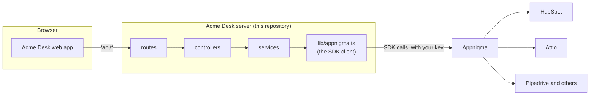

# Appnigma sample app

A small SaaS product, **Acme Desk**, that gives its customers integrations through
the [Appnigma SDK](https://www.npmjs.com/package/@appnigma/sdk). Its customers
connect their CRM (HubSpot, Attio or Pipedrive), see their own companies,
contacts and deals inside the product, and add contacts that land in their CRM.

Acme Desk's own code never talks to HubSpot, Attio or Pipedrive. It makes a
handful of SDK calls. Appnigma builds, runs and maintains the integrations
behind them.

Use it as a reference: every SDK call lives in [`server/src/services`](server/src/services),
one file per flow.

## Run it in five minutes

You need Node 22 or newer and an Appnigma SDK key (it starts with `apn_live_`).

```sh
git clone https://github.com/Appnigma/appnigma-sample-app.git
cd appnigma-sample-app
cp .env.example .env    # then put your key in APPNIGMA_SDK_KEY
npm install
npm run dev
```

Open http://localhost:4701 and sign in as one of the sample workspaces.

Connecting a platform sends your customer to the platform and back to
`PUBLIC_URL`. Appnigma only sends people back to an https address, so on your
own machine either set `RETURN_PAGE_URL` to an https page that forwards them
on to `PUBLIC_URL`, or run a tunnel such as ngrok and set `PUBLIC_URL` to its
https address.

## How this app uses Appnigma

| Step | What the user sees | The code |
| --- | --- | --- |
| 1. Create one client | Nothing: it runs on the server | [`lib/appnigma.ts`](server/src/lib/appnigma.ts) |
| 2. Show integrations and connect a customer | The Integrations page and the Connect button | [`services/integrations.service.ts`](server/src/services/integrations.service.ts) |
| 3. Read and write their CRM data | The Customers page and Add a contact | [`services/customers.service.ts`](server/src/services/customers.service.ts) |
| 4. Run ready-made actions | The Calls page (Gong transcripts), shown once Gong is switched on | [`services/calls.service.ts`](server/src/services/calls.service.ts) |
| Handle every failure | A clear message instead of a crash | [`api/controllers/respond.ts`](server/src/api/controllers/respond.ts) |

Each step has a short page in [`docs/`](docs), with a diagram and the exact calls.

Here is all of step 1:

```ts
import { Appnigma } from "@appnigma/sdk";

// Reads your key from APPNIGMA_SDK_KEY. One client for the whole server.
const appnigma = new Appnigma();
```

And reading a customer's contacts, whichever CRM they use:

```ts
const page = await appnigma.crm.contacts.list({ endCustomerId: "Brightline Legal", platform: "hubspot" });
for (const contact of page.records) console.log(contact.fullName, contact.emails[0]?.value);
```

Open **Under the hood** in the app's top bar to watch each SDK call a page
makes, with the line of code that made it.

## How it fits together



- The browser only talks to this app's own server. The SDK key never leaves the server.
- The server is layered: routes wire paths, controllers check input and shape answers, services hold the SDK calls.
- Appnigma keeps each customer's connection and talks to their platforms.

## Project layout

```
server/src/
  lib/appnigma.ts        the one SDK client
  services/              every SDK call, one file per flow
  api/routes/            paths and middleware
  api/controllers/       input checks, answers, error handling
  types/  schemas/  constants/  config/
web/src/
  pages/                 Home, Customers, Integrations, one integration, Calls
  components/            layout, Under the hood panel
docs/                    one page per flow
```

## Make it your own

1. Set `PRODUCT_NAME` and `BRAND_COLOR` in `.env`.
2. Set `PUBLIC_URL` to the https address your users reach. The connect flow sends them back there.
3. Replace the sign-in stand-in (`api/controllers/app.controller.ts` and `constants/accounts.ts`) with your own login. Use your own stable id for each customer as their `endCustomerId`.
4. One account in a platform (one HubSpot portal, say) can be connected by one of your customers at a time. A second customer connecting the same account is refused, so each customer's data stays their own.

The **Under the hood** panel and `lib/sdk-call-log.ts` are only there to show
the calls; you can delete both.

## Ask from Claude Code

Add Appnigma to Claude Code to ask for integrations and check their status from your editor:

```sh
claude mcp add --transport http appnigma https://engine.appnigma.ai/mcp
```

See [docs/06-claude-code.md](docs/06-claude-code.md).

## Build for production

```sh
npm run build
npm start
```

The server serves the built web app, so one process and one address run everything.

## License

MIT. See [LICENSE](LICENSE).
