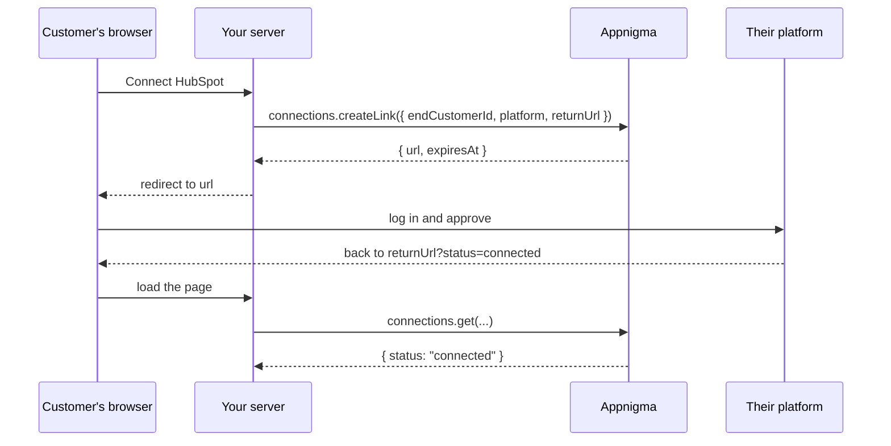

# 1. Show integrations and connect a customer

Code: [`server/src/services/integrations.service.ts`](../server/src/services/integrations.service.ts)

## The Integrations page

`platforms.list()` answers every platform switched on for your company. When
Appnigma adds one for you, it appears here with no change to your code.

For each platform, `connections.get()` says whether this customer connected it.
A customer who never connected a platform is not a status: the SDK raises
`SdkNotFoundError`, which simply means "not connected yet".

```ts
const { platforms } = await appnigma.platforms.list();

const statusOf = async (endCustomerId: string, platform: string) => {
  try {
    return (await appnigma.connections.get({ endCustomerId, platform })).status;
  } catch (error) {
    if (error instanceof SdkNotFoundError) return "not_connected";
    throw error;
  }
};
```

## Connecting

Connecting is a redirect. Your server asks for a link, the customer approves on
the platform, and they land back on your `returnUrl`.



```ts
const link = await appnigma.connections.createLink({ endCustomerId, platform, returnUrl });
// send the customer to link.url
```

- A link works once and expires after 15 minutes. Ask for a new one each time.
- `returnUrl` must be HTTPS in production.
- The connection is written before the customer lands back, so `connections.get` already answers `connected`.

## Disconnecting

```ts
await appnigma.connections.disconnect({ endCustomerId, platform });
```

Their login on that platform is removed. A new link connects them again from the start.
