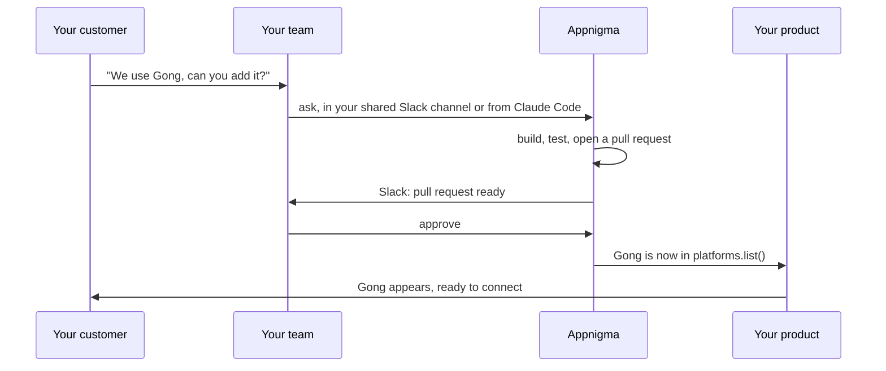

# 5. New integrations, without new code

Code: [`server/src/features/integrations.ts`](../server/src/features/integrations.ts)

The Integrations page is built from `platforms.list()`. When Appnigma ships a
new integration for you, it shows up there, ready to connect. Your team does
not write or deploy anything.



```ts
const { platforms } = await appnigma.platforms.list();
// [{ platform: "hubspot", label: "HubSpot", ... }, { platform: "gong", ... }]
```

To ask from your editor, see [docs/06-claude-code.md](06-claude-code.md).
